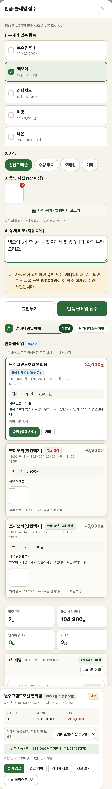
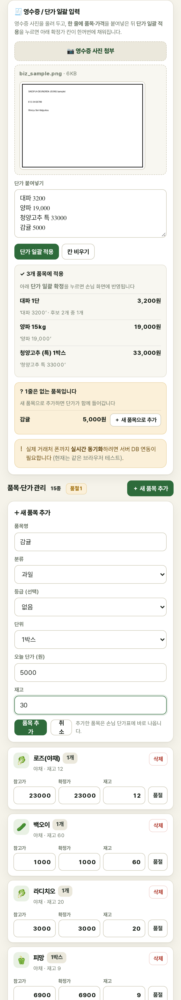

# 훈이네과일야채 · 원주 반곡점 — 야채·식자재 B2B 발주 (시안)

원주 시내 사업자 거래처를 위한 야채·식자재 B2B 발주 시스템 프론트 시안입니다.
화면은 **손님(거래처)용**과 **사장님용** 두 장으로 나뉘고, 데이터는 **공용 DB(Supabase)** 에 저장됩니다.
브라우저 localStorage는 빠른 캐시로 함께 쓰기 때문에, 인터넷이 없거나 파일로 열어도 화면은 그대로 동작합니다.
**손님 폰과 사장님 폰이 서로 달라도** 같은 주문·단가·가격·사진 접수를 봅니다(5초마다 맞춤).

| 화면 | 파일 | 내용 |
|---|---|---|
| 손님(거래처)용 | `index.html` | 내 가게로 로그인 → B2B 발주 · 발주 내역 · 거래명세표 — 사장님 관리 메뉴 없음, 다른 거래처 정보 없음 |
| 사장님용 | `admin.html` | 열면 바로 사장님 관리 — 주문현황·배차, 아침 7시 단가 확정, 거래처 승인·미수·전환, A4 인쇄 |

손님 화면은 **40~60대 식당 사장님 눈높이**로 만들었습니다 — 첫 화면에서 배달 **날짜(오늘/내일)**와
**회차(1차 08:00 · 2차 11:00 · 3차 13:00)**를 큰 버튼으로 고르고, 바로 아래 품목·가격·`+ 담기`가 보입니다.
(글씨·버튼 확대, 긴 설명은 3줄 안내로 압축, 미수 잔액이 있을 때만 큰 경고 배너)

## 반품·클레임 · 거래처 등급 (2026-11-20 밤 · v8)

- **반품·클레임 사진 접수** — 손님 `발주 내역` 에서 **배송중·배송완료** 주문 카드의 **`반품·클레임`** 버튼 →
  ① 문제 품목(그 주문 품목 중 선택 · 금액 표시) ② 사유(`신선도/파손` `수량 부족` `오배송` `기타`)
  ③ 증빙 사진(휴대폰 사진 그대로 · 미리보기 · 최대 3장) ④ 상세 메모 → 접수하면 카드에 **`클레임 접수됨(확인중)`** 배지가 붙습니다.
  사진은 1000px 이하로 줄여 저장해 폰 사진도 그대로 올라갑니다.
- **사장님 처리** — 사장님 `주문현황` 탭 **맨 위**에 반품·클레임 섹션(접수 건수 배지). 사진 썸네일을 누르면 크게 보이고,
  **`승인 (금액 차감)`** 이면 그 품목 금액만큼 주문 합계와 미수 잔액에서 빠지며(전표에도 `반품 차감` 줄),
  **`반려`** 면 금액은 그대로입니다. 손님 카드 배지도 `반품 승인 · 금액 차감` / `반품 반려` 로 바뀝니다.
- **거래처 등급 (사장님만)** — `거래처·미수` 탭 카드마다 **등급 선택** 드롭다운:
  `일반 (1일)` / `우수 (7일)` / `VIP·호텔·식장 (15일)`. 등급이 높을수록 외상(미수)을 오래 줍니다.
  **기한이 지난(연체) 미수가 있을 때만** 다음 발주가 막히고, 기한 안 미수는 그대로 두고 발주할 수 있습니다.
  `10만 원 이상 즉시결제` 는 **일반 등급에만** 적용 — 호텔·식장은 10만 원 이상도 약정 외상으로 접수됩니다.
- **손님 화면에는 절대 안 보임** — 등급명·등급 배지·기한 일수는 손님 화면 어디에도 나오지 않습니다.
  손님은 늘 쓰던 화면 그대로이고, 결제 안내만 `외상(약정)` 처럼 중립적으로 바뀝니다(막혔을 때는 연체 금액만 안내).

## 사장님 화면 · 가입에서 바뀐 것 (2026-11-20 밤)

- **품목 추가 · 삭제** — `아침 7시 단가 확정` 탭의 **`＋ 새 품목 추가`** 로 품목명·분류(야채 / 양념·파·마늘 / 과일)·
  등급(특·상·없음)·단위(1박스 / 1kg / 1단 / 1개 / 15kg / 20kg)·오늘 단가·재고를 넣어 바로 추가합니다.
  품목마다 **`삭제`** 버튼(확인 창 → 삭제)이 있어 취급 안 하는 품목을 바로 뺍니다.
- **가격 · 재고 변동** — 품목 줄마다 **참고가 · 확정가 · 재고** 입력칸과 **`품절` / `판매 재개`** 버튼.
  참고가를 바꾸면 확정가 칸도 따라가고, 재고를 0으로 넣으면 품절로 바뀝니다. 바뀐 값은 공용 DB에 올라가
  **손님 화면 단가표(가격·재고·품절·분류)에 바로 반영**됩니다(다른 기기의 손님 화면까지).
- **영수증 / 단가 일괄 입력** — 단가 확정 탭 맨 위. 영수증 **사진을 첨부**(미리보기)해 두고,
  `대파 2800` `양파 18,500` `청양고추 특 32000` 처럼 **한 줄에 품목·가격**을 붙여넣은 뒤 **`단가 일괄 적용`** 을 누르면
  매칭되는 품목의 확정가가 한꺼번에 채워집니다. 등급(`특`)·단위(`1kg`)·콤마(18,500)를 알아서 맞추고,
  **없는 품목은 `＋ 새 품목으로 추가`** 로 이어집니다(분류·그림을 이름에서 짐작해 채워 줌).
  고친 단가는 공용 DB로 올라가 거래처 폰의 단가표에도 그대로 반영됩니다.
- **간편 가입 + 사장님 승인** — 손님 `＋ 거래처 가입` 은 **사업자등록증 없이** 상호·대표자(담당자)·전화번호·배달 주소만으로
  신청됩니다(사업자등록번호·사업자등록증 사본은 선택). 신청하면 `승인 대기(PENDING)` 이고, 사장님 화면
  `거래처·미수` 탭에서 **`승인 (OK)`** 을 누르면 `APPROVED` 로 바뀌어 손님이 **상호명+전화번호로 바로 로그인·발주**합니다.
  `사업자등록증 필수`·`사업자 전용` 문구는 **`사장님 승인 후 이용`** 으로 바꿨습니다.

## 손님 화면에서 바뀐 것 (2026-11-20)

- **쉬운 분류** — `엽채류·과채류·근채류·양념채소` 대신 **전체 · 야채 · 양념·파·마늘 · 과일**.
  (로즈·라디치오·백오이·피망·애호박·감자·무 → 야채 / 양파·대파·깐마늘·청양고추 → 양념·파·마늘 / 레몬 → 과일)
- **큼직한 품목 검색창** — `품목 이름 검색 (예: 대파, 양파)`. 띄어쓰기 무시, 결과가 없으면 `전체 품목 보기`.
- **다른 거래처 정보 차단** — 상단의 거래처 선택 드롭다운을 없앴습니다. 손님 화면에는 **내 가게 1곳**만 보이고,
  들어올 때는 **상호명 + 전화번호**로 로그인합니다. 거래처 목록·전환은 사장님 화면 `거래처·미수` 탭에만 있습니다.
- **거래명세표는 보기만** — 손님은 A4 전표(공급받는자용·공급자용) 그대로를 폰에서 확인만 합니다.
  `A4 인쇄` 버튼과 인쇄 안내는 사장님 화면에만 남겼습니다.

## 손님 화면 추가 기능 (2026-11-20 저녁)

- **어제 주문 그대로 담기** — 배달 선택 바로 아래 큰 버튼. 그 가게가 마지막으로 넣은 발주의 품목·수량을
  장바구니에 한 번에 채웁니다(10초 발주). 품절·재고 부족 품목은 빼고 **무엇이 빠졌는지 토스트로 안내**하고,
  지난 발주가 없는 가게에는 인기 품목 안내를 보여 줍니다.
- **등급·단위 다품목 15종** — `청양고추 (특) 1박스` · `청양고추 (상) 1박스` · `청양고추 1kg` 처럼 같은 품목도
  등급·단위별로 따로 담습니다. 카드에는 품목 이름과 **`특 · 1박스` / `1kg` 배지**가 크게 붙습니다.
- **검색 강화** — 공백·괄호를 무시하고 **여러 낱말 AND** 로 찾습니다. `청양 박스` → 특/상 1박스만,
  `청양 특` → 특만, `청양 1키로` → `1kg` 까지 맞춥니다. 품목이 50~100개로 늘어도 바로 찾습니다.
- **전일 대비 단가 ▲▼** — 전날 확정가와 비교해 내리면 `▼ 2,000원`(파랑), 오르면 `▲ 1,500원`(빨강).
  변동이 없으면 표시하지 않습니다. 사장님이 아침 7시 단가를 확정하면 손님 화면 금액과 ▲▼가 자동으로 다시 계산됩니다.
- **4단계 진행 상태** — `① 주문 접수 → ② 단가 확정 → ③ 배달 출발 → ④ 배송 완료` 스텝 바를
  발주 내역 카드마다, 그리고 주문이 있으면 **첫 화면 상단 요약**에도 크게 보여 줍니다.
  사장님이 단가 확정 / 배송 시작 / 배송 완료를 누르면 손님 화면이 **공용 DB를 다시 읽어 바로 따라갑니다**(storage 이벤트 + 1.2초 확인 + 5초 폴링).

두 화면은 **공용 DB(`app_state` 의 `b2b_state`)를 함께 씁니다**(기기 저장소 `hoonie_b2b_veg_v3` 는 캐시).
거래처 폰에서 발주한 주문이 사장님 폰 화면에 그대로 보이고, 사장님이 입금을 처리하면 거래처 발주가 다시 열립니다.
장바구니(`hoonie_b2b_veg_v3_cart`)와 '내 가게'(currentClientId)는 기기마다 따로 둡니다.

## 바로 보기

- 손님용(거래처): https://htmlpreview.github.io/?https://github.com/hhh3350-lab/hoonie-b2b/blob/main/index.html
- 사장님용: https://htmlpreview.github.io/?https://github.com/hhh3350-lab/hoonie-b2b/blob/main/admin.html
- GitHub Pages(켜져 있으면): https://hhh3350-lab.github.io/hoonie-b2b/ · https://hhh3350-lab.github.io/hoonie-b2b/admin.html

## 주요 규칙

- 간편 가입 — 사업자등록증 없이 신청, 사장님 확인·승인(OK) 후 발주 가능
- 외상은 거래처 등급 기한 — 일반 1일 · 우수 7일 · VIP·호텔·식장 15일 (기한 지난 미수가 있으면 발주 잠김)
- 10만 원 이상은 즉시 결제(일반 등급) — 계좌 이체 후 `입금 완료(결제 확인 요청)`
- 반품·클레임 — 손님이 사진으로 접수, 사장님이 승인하면 그 품목 금액만큼 미수에서 차감
- 최소 주문 50,000원 · 원주 시내 무료배송 · 배달 1차 08:00 / 2차 11:00 / 3차 13:00~14:00
- 전표는 A4 거래명세표(공급받는자용 + 공급자용 2매) — 손님은 화면으로 보고, 인쇄는 사장님이 회차·당일 일괄로

## 구성

| 파일 | 내용 |
|---|---|
| `index.html` | 손님 화면 — 내 가게 로그인·단가표·검색·장바구니·발주서·주문현황·A4 거래명세표 보기 |
| `admin.html` | 사장님 관리 화면(품목·단가 관리·영수증 일괄 입력·배차·거래처 승인/미수/전환·일괄 인쇄·설정) |
| `assets/app.css` | 두 화면이 함께 쓰는 스타일 1벌 (예전엔 두 HTML 에 똑같이 84KB 씩 들어 있었음) |
| `assets/app.js` | 두 화면이 함께 쓰는 코드 1벌 — 화면 구분은 `window.__HOONIE_MODE`(`client`/`admin`) |
| `img/fruit/` | 과일 완전도매 상품 사진 12장(webp, 총 124KB) — 예전엔 두 HTML 에 base64 로 165KB 씩 들어 있었음 |
| `preview-claim-tier-v8.png` | 반품·클레임(손님 접수 · 사장님 승인) + 거래처 등급(15일 결제) 미리보기 |
| `preview-client-v6.png` | 손님 화면 미리보기 — 어제 주문 담기 · 청양 특/상/1kg · ▲▼ · 4단계 진행 바 |
| `preview-admin-v7.png` | 사장님 화면 미리보기 — 영수증 일괄 입력 · 품목 추가/삭제 · 가격·재고·품절 |
| (로컬) `B2B_SERVER_NOTES.md` | 서버 전환 시 API 대응표 — 이 저장소에는 포함하지 않음 |

데모용 샘플 데이터입니다. 품목 단가·거래처·미수 내역은 실제 값이 아닙니다.
손님 화면은 시연 편의를 위해 처음 열면 `쪼끼쪼끼[단관택지]` 가게로 들어간 상태로 시작합니다.

## 속도·모바일 최적화 (2026-11-24)

기능·디자인·화면 문구는 그대로 두고 **중복 코드와 무거운 자원만** 정리했습니다.
(Supabase 쓰기 요청은 테스트 중 전부 차단 — 실제 주문·단가 데이터는 하나도 바뀌지 않았습니다.)

| 항목 | 전 | 후 |
|---|---|---|
| `index.html` | 349KB (CSS 84KB + JS 254KB 가 안에) | 12KB + 공용 `assets/app.css`·`assets/app.js` |
| `admin.html` | 343KB (같은 CSS·JS 를 또 복사) | 6KB + **같은** 공용 파일(브라우저가 한 번만 받음) |
| 두 화면 코드 합계 | 692KB | 356KB (공용 1벌) |
| `fruit-wholesale.html` | 223KB (사진 165KB 가 base64 로 안에) | 58KB + `img/fruit/*.webp` |
| `fruit-wholesale-admin.html` | 205KB (같은 사진 165KB 또) | 40KB + 같은 사진 1벌(총 124KB) |
| 웹폰트(Pretendard) | 747~774KB짜리 글꼴 5개 = **3,845KB** | variable dynamic-subset — 화면에 쓰인 글자 조각만 **367KB** |
| 390px 터치 영역 44px 미만 | 손님 22곳 · 사장님 23곳 · 과일 1곳 | **0곳** (전 화면) |

- **왜 빨라지나** — 예전에는 사장님이 손님 화면에서 사장님 화면으로 넘어가도 333KB 코드를 또 받았고,
  글꼴 5개(3.8MB)를 다 받을 때까지 화면 로딩이 끝나지 않았습니다. 지금은 공용 파일을 한 번만 받고(캐시),
  글꼴은 이 화면에 실제로 쓰인 글자 조각만 받습니다.
- **모바일에서 손본 것** — 390px 기준 ① 상단 거래처 이름이 `쪼끼쪼끼[단…` 로 잘리던 것 → 전체가 보이게
  ② 즐겨찾기 별(30×26)·사장님 탭(34px)·날짜 칩(32px)·작은 버튼(28~38px) → 40~44px
  ③ 11~11.5px 안내문 → 12.5px ④ 사장님 탭이 옆으로 잘릴 때 오른쪽에 사라지는 그라데이션 힌트
- 코드를 고치면 `index.html`·`admin.html` 의 `assets/app.css?v=20261124` 처럼 **`?v=` 날짜만 올려 주세요**
  (브라우저 캐시 때문에 예전 파일을 계속 쓰는 것을 막습니다)
- 검증 스크립트: `work/b2b-opt/smoke.py`(기능 36항목 전후 비교) · `audit.py`(390/1280 렌더링·터치영역) · `perf.py`(Slow 4G 로딩)

## 단구점 소매몰 — `huns-fruit.github.io` 로 이전 (2026-11-23)

소매몰(손님 화면·사장님 화면)은 **이 저장소를 떠나 `huns-fruit/huns-fruit.github.io` 로 배포**합니다.
이 저장소의 `shop.html` · `shop-admin.html` 은 **옛 링크를 새 주소로 넘기는 안내 페이지**만 남겼습니다.

| 옛 주소 (이 저장소) | 지금 주소 (정본) |
|---|---|
| `https://hhh3350-lab.github.io/hoonie-b2b/shop.html` | **https://huns-fruit.github.io/** — 계산대 QR·인쇄물 주소 |
| `https://hhh3350-lab.github.io/hoonie-b2b/shop-admin.html` | **https://huns-fruit.github.io/admin.html** |

- 소매몰 코드·사진·설명은 `huns-fruit/huns-fruit.github.io` 저장소와 워크스페이스 `hoonie-retail/` 에 있습니다.
- 이 저장소는 **도매 B2B(거래처 발주 · `index.html`)** 전용으로 씁니다.
  주문은 `retail_orders`, 사진 접수는 `retail_claims`, 상품 가격·품절·남은 수량·코멘트·등급은 `app_state`(`retail_catalog`)에 저장됩니다.
  손님 화면은 **그 기기에서 넣은 주문만** 봅니다(다른 손님 주문·연락처는 보이지 않음).
- **주문 4단계(2026-11-23)** — `received`(손님 `접수 대기` / 사장님 `새 주문`·**접수하기**) → `accepted`(손님 `주문 접수` / 사장님 `접수 완료`·**배달 출발**·**포장 준비 완료**) → `delivering`·`ready`(손님 **`🚚 배달 시작`**·**`🛍️ 픽업 가능`** / 사장님 `배달 중`·`픽업 대기`·**배달 완료**·**픽업 완료**) → `done`(`✅ 배달 완료`·`✅ 픽업 완료`). 배달기사는 폰으로 `shop-admin.html` 을 열고 `배달 완료` 만 누르면 됩니다. 예전 `preparing` 주문은 읽을 때 자동 변환됩니다.
- **무통장입금 계좌** — 주문서에서 `무통장입금` 을 고르면 `NH농협은행 302-1803-5017-81 (예금주: 황관훈)` 박스·`계좌번호 복사` 버튼·`입금이 확인된 후 상품 준비 및 배달이 출발합니다.` 안내가 나오고, 무통장입금 주문의 완료 화면에도 함께 나옵니다.
- **결제 수단 잠금(2026-11-23)** — PG 연결 전까지 `PAY_ONLY = "bank"`. 주문서를 열면 무통장입금이 이미 선택돼 있고 **계좌 박스가 누르지 않아도 바로 보입니다**. 다른 수단은 `disabled` + `.off` 회색 스타일 + `PG 준비 중` 배지, 클릭 위임 핸들러와 `renderCheckout()`·`pay()` 세 곳에서 무통장입금으로만 고정합니다.
- **새 주문 폰 푸시(ntfy)** — 손님이 주문하면 `https://ntfy.sh/hoonie-dangu-order-914288` 로 `Title: Hoonie Dangu New Order`·`Priority: high`·`Tags: bell,strawberry`·본문 `새 주문! [배달|포장] · 이름님 · 금액원` 을 비동기로 보냅니다(실패해도 주문은 그대로). 사장님 폰 ntfy 앱에서 그 주제를 구독하면 됩니다.

## 과일 완전도매 `fruit-wholesale.html` · 사장님 `fruit-wholesale-admin.html` (2026-11-22)

과일 박스**만** 모은 도매 발주 화면입니다(위 두 시스템과 별개). 화면 코드(CSS·JS)는 각 파일에 들어 있고,
상품 사진만 `img/fruit/*.webp` 로 빼서 두 화면이 같은 사진을 함께 씁니다(2026-11-24).

| 화면 | 파일 | 내용 |
|---|---|---|
| 손님(거래처) | `fruit-wholesale.html` | 과일 12종 박스 · 카테고리 5개(전체/딸기·베리/감귤·만감/사과·배·감/포도·수입과일) · `−/＋` 수량 · **최소 20만 원** 하단 바 · 발주서 · 발주내역 조회 |
| 사장님 | `fruit-wholesale-admin.html` | 들어온 발주 확인 · 상태(접수→준비중→배송중→완료) · 품목별 박스 단가·품절·최소주문금액 저장 |

- 열어 보기: `https://hhh3350-lab.github.io/hoonie-b2b/fruit-wholesale.html`
- 사장님: `https://hhh3350-lab.github.io/hoonie-b2b/fruit-wholesale-admin.html`
- 미리보기: `preview-fruit-wholesale.png`(모바일 손님) · `preview-fruit-wholesale-admin.png`(모바일 사장님) · `preview-fruit-wholesale-desktop.png`
- **최소 배송 200,000원** — 하단 고정 바에 `상품 O종 · Okg` / `총액` 과 `OO,OOO원 더 담으면 배송 가능` 이 뜨고, 넘으면 초록 배지로 바뀌며 `발주하기` 가 열립니다.
- 발주서: 상호 · 담당자 연락처 · 배송 주소 · 희망 배송일 · 요청 메모 · 결제방식(계좌이체 / 거래처 정산 협의) → 접수번호 `FW20261122-4821`.
- 공용 DB는 `app_state` 의 `fruit_wholesale_catalog`(단가·품절·최소주문) · `fruit_wholesale_orders`(발주서) 키를 씁니다. 사장님 화면은 발주 전부를, 손님 화면은 **이 기기에서 넣은 발주만** 봅니다.
- 사장님 화면은 로그인이 없습니다(주소를 아는 사람이 열 수 있음). 발주서에 상호·연락처·주소가 들어가므로 필요하면 비밀번호를 붙이는 것을 권합니다.
