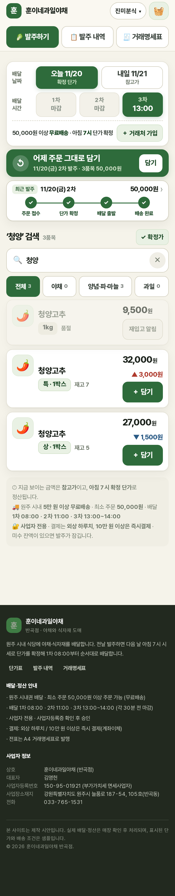

# 훈이네과일야채 · 원주 반곡점 — 야채·식자재 B2B 발주 (시안)

원주 시내 사업자 거래처를 위한 야채·식자재 B2B 발주 시스템 프론트 시안입니다.
화면은 **손님(거래처)용**과 **사장님용** 두 장으로 나뉘고, 데이터는 브라우저 localStorage에만 저장됩니다(서버 없음).

| 화면 | 파일 | 내용 |
|---|---|---|
| 손님(거래처)용 | `index.html` | 내 가게로 로그인 → B2B 발주 · 발주 내역 · 거래명세표 — 사장님 관리 메뉴 없음, 다른 거래처 정보 없음 |
| 사장님용 | `admin.html` | 열면 바로 사장님 관리 — 주문현황·배차, 아침 7시 단가 확정, 거래처 승인·미수·전환, A4 인쇄 |

손님 화면은 **40~60대 식당 사장님 눈높이**로 만들었습니다 — 첫 화면에서 배달 **날짜(오늘/내일)**와
**회차(1차 08:00 · 2차 11:00 · 3차 13:00)**를 큰 버튼으로 고르고, 바로 아래 품목·가격·`+ 담기`가 보입니다.
(글씨·버튼 확대, 긴 설명은 3줄 안내로 압축, 미수 잔액이 있을 때만 큰 경고 배너)

## 손님 화면에서 바뀐 것 (2026-11-20)

- **쉬운 분류** — `엽채류·과채류·근채류·양념채소` 대신 **전체 · 야채 · 양념·파·마늘 · 과일**.
  (로즈·라디치오·백오이·피망·애호박·감자·무 → 야채 / 양파·대파·깐마늘·청양고추 → 양념·파·마늘 / 레몬 → 과일)
- **큼직한 품목 검색창** — `품목 이름 검색 (예: 대파, 양파)`. 띄어쓰기 무시, 결과가 없으면 `전체 품목 보기`.
- **다른 거래처 정보 차단** — 상단의 거래처 선택 드롭다운을 없앴습니다. 손님 화면에는 **내 가게 1곳**만 보이고,
  들어올 때는 **상호명 + 전화번호**로 로그인합니다. 거래처 목록·전환은 사장님 화면 `거래처·미수` 탭에만 있습니다.
- **거래명세표는 보기만** — 손님은 A4 전표(공급받는자용·공급자용) 그대로를 폰에서 확인만 합니다.
  `A4 인쇄` 버튼과 인쇄 안내는 사장님 화면에만 남겼습니다.

## 손님 화면 추가 기능 (2026-11-20 저녁)

- **어제 주문 그대로 담기** — 배달 선택 바로 아래 큰 버튼. 그 가게가 마지막으로 넣은 발주의 품목·수량을
  장바구니에 한 번에 채웁니다(10초 발주). 품절·재고 부족 품목은 빼고 **무엇이 빠졌는지 토스트로 안내**하고,
  지난 발주가 없는 가게에는 인기 품목 안내를 보여 줍니다.
- **등급·단위 다품목 15종** — `청양고추 (특) 1박스` · `청양고추 (상) 1박스` · `청양고추 1kg` 처럼 같은 품목도
  등급·단위별로 따로 담습니다. 카드에는 품목 이름과 **`특 · 1박스` / `1kg` 배지**가 크게 붙습니다.
- **검색 강화** — 공백·괄호를 무시하고 **여러 낱말 AND** 로 찾습니다. `청양 박스` → 특/상 1박스만,
  `청양 특` → 특만, `청양 1키로` → `1kg` 까지 맞춥니다. 품목이 50~100개로 늘어도 바로 찾습니다.
- **전일 대비 단가 ▲▼** — 전날 확정가와 비교해 내리면 `▼ 2,000원`(파랑), 오르면 `▲ 1,500원`(빨강).
  변동이 없으면 표시하지 않습니다. 사장님이 아침 7시 단가를 확정하면 손님 화면 금액과 ▲▼가 자동으로 다시 계산됩니다.
- **4단계 진행 상태** — `① 주문 접수 → ② 단가 확정 → ③ 배달 출발 → ④ 배송 완료` 스텝 바를
  발주 내역 카드마다, 그리고 주문이 있으면 **첫 화면 상단 요약**에도 크게 보여 줍니다.
  사장님이 단가 확정 / 배송 시작 / 배송 완료를 누르면 손님 화면이 **같은 localStorage 를 다시 읽어 바로 따라갑니다**(storage 이벤트 + 1.2초 확인).

두 화면은 **같은 도메인의 localStorage(`hoonie_b2b_veg_v3`)를 공유**합니다. 한 브라우저에서
손님으로 발주한 주문이 사장님 화면에 그대로 보이고, 사장님이 입금을 처리하면 손님 발주가 다시 열립니다.

## 바로 보기

- 손님용(거래처): https://htmlpreview.github.io/?https://github.com/hhh3350-lab/hoonie-b2b/blob/main/index.html
- 사장님용: https://htmlpreview.github.io/?https://github.com/hhh3350-lab/hoonie-b2b/blob/main/admin.html
- GitHub Pages(켜져 있으면): https://hhh3350-lab.github.io/hoonie-b2b/ · https://hhh3350-lab.github.io/hoonie-b2b/admin.html

## 주요 규칙

- 사업자 전용 가입 — 사업자등록증 확인 후 사장님 승인 → 발주 가능
- 외상은 하루치 — 미수 잔액이 있으면 다음 발주 잠김, 전액 입금 시 재개
- 10만 원 이상은 즉시 결제 — 계좌 이체 후 `입금 완료(결제 확인 요청)`
- 최소 주문 50,000원 · 원주 시내 무료배송 · 배달 1차 08:00 / 2차 11:00 / 3차 13:00~14:00
- 전표는 A4 거래명세표(공급받는자용 + 공급자용 2매) — 손님은 화면으로 보고, 인쇄는 사장님이 회차·당일 일괄로

## 구성

| 파일 | 내용 |
|---|---|
| `index.html` | 손님 화면 — 내 가게 로그인·단가표·검색·장바구니·발주서·주문현황·A4 거래명세표 보기 |
| `admin.html` | 사장님 관리 화면(단가 확정·배차·거래처 승인/미수/전환·일괄 인쇄·설정) |
| `preview-client-v6.png` | 손님 화면 미리보기 — 어제 주문 담기 · 청양 특/상/1kg · ▲▼ · 4단계 진행 바 |
| (로컬) `B2B_SERVER_NOTES.md` | 서버 전환 시 API 대응표 — 이 저장소에는 포함하지 않음 |

데모용 샘플 데이터입니다. 품목 단가·거래처·미수 내역은 실제 값이 아닙니다.
손님 화면은 시연 편의를 위해 처음 열면 `쪼끼쪼끼[단관택지]` 가게로 들어간 상태로 시작합니다.
